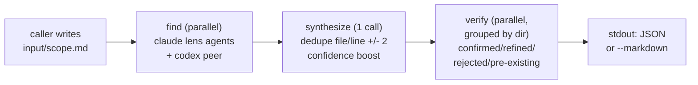
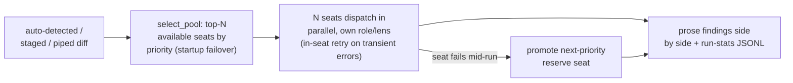

# review vs revmux — a detailed comparison

**TL;DR:** both tools exist to stop a single model from grading its own homework, and both are
meant to be *driven by a coding agent*, not typed by a human every time. Past that, they are
built for different jobs. **[revmux](https://github.com/umputun/revmux)** (Go, umputun) is a
narrow, supervised **process manager**: it spawns `claude --print` and `codex exec` as
subprocesses it owns, watches them in a terminal TUI, and returns one structured JSON report
with a schema stable enough for a caller to parse without reading prose — and it explicitly
reviews *anything*, not just diffs (a PR, a plan, a design doc, a filed issue). **`review`**
(Python, this repo) is a wider **panel + decision** tool: a 15-seat priority-ordered board
across many providers (Anthropic, OpenAI/Codex, and opencode's gateway to xAI/GLM/Qwen/DeepSeek/
Kimi, plus Gemini's own REST API) with multi-layer failover and per-seat reliability tracking,
plus modes revmux has no equivalent for — a cited **quorum**, a multi-round **brainstorm**,
**visual** screenshot review, and one narrow un-caged **`qa`** write/exec tester. revmux's core
interface is its JSON findings contract; `review`'s core interface is a human-readable panel,
with JSON reserved for its management/introspection commands (`task`, `stat`, `entities`,
`jobs`, `visual`), not the review findings themselves.

Neither tool generates code. Neither posts to a PR host. Both shell out to model CLIs you
already have instead of running their own hosted service. If you want the tool that also *writes*
code and commits it, see `review`'s own [ralphex comparison](../README.md#review-vs-ralphex--the-whole-loop-vs-the-review-primitive) —
revmux doesn't do that either.

---

## What each tool is, in its own terms

**revmux** spawns and supervises `claude`/`codex` subprocesses, then returns findings on stdout
as JSON or markdown. It is normally launched *by* a coding agent's skill, which writes the
review context to disk as a **task round** (`.revmux/tasks/<task>/<run>/input/scope.md`, plus
optional `goal.md`/`profile.md`/`context/`), then runs `revmux --task … --run …`. revmux itself
does no scope detection, no git operations, no PR fetching, and no source modification — the
caller does all of that and hands revmux a filled round.

**`review`** runs your git diff (auto-detected, staged, or piped) through several backend model
CLIs/APIs in parallel and prints their findings side by side, or drives a two-phase cited
**quorum**, a multi-round **brainstorm**, a standalone/composable **visual** verdict, or (the one
un-caged exception) a write/exec **`qa`** tester against a running system-under-test. Every
recorded mode ties its run to a `--task CODE`, so `review task CODE` and a web dashboard can
show iteration history — but `review` computes its own diff and dispatches its own board; it
does not require (or support) a caller-written round directory the way revmux does.

---

## Architecture side by side

revmux's pipeline is three fixed stages per round:

`review diff`'s pipeline is a priority board with two layers of failover, dispatched per invocation:

| Axis | revmux | review |
|---|---|---|
| Language / distribution | Go; Homebrew, `.deb`/`.rpm`, `go install`, `make install` | Python; one-liner install script or `pipx install` |
| Runs as | supervised subprocesses (`claude --print`, `codex exec`) with a watchdog per process | subprocess CLI calls (`claude`, `codex`, `opencode`) **and** stateless keyed-HTTP calls (Gemini, some commandcode/z.ai routes), no persistent supervisor process |
| Model surface | exactly two binaries: claude and codex (each roster entry still picks its own model + effort string, e.g. `codex/gpt-6-sol:xhigh`) | a 15-seat priority board spanning Anthropic, OpenAI/Codex, and opencode's gateway to xAI, GLM, Qwen, DeepSeek, Kimi, plus Gemini's REST API |
| Review target | not just code — a branch, PR, plan, design doc, or proposal all go in via the same three-stage pipeline (`triage` profile) | diffs by default; open, non-diff questions go through separate modes (`just-ask`, `quorum`, `brainstorm`) instead of one review verb |
| Config-as-code | `.revmux/` (profiles, lenses, severity bar) is checked into the *target* repo, versioned and diffable | `config.yaml`/env vars select models/board/presets for the *tool itself*; no per-project checked-in lens-file directory |
| Consensus mechanism | confidence boost from distinct **processes** agreeing on a finding, plus a directory-grouped verify stage (details below) | two-phase cited **quorum** with an optional adversarial refutation pass (details below) |
| Persona / lens model | 13 built-in lenses, composed per roster entry, checked into `.revmux/lenses/` | a 6-persona pool for quorum/brainstorm; the diff board pins one fixed role/lens per model instead |
| Failover / recovery | kill + retry once, then degrade; a fully-degraded pool is a tool error | three layers — startup failover, mid-run reserve promotion, and an escalating cross-invocation cooldown (details below) |
| In-flight retry | one retry per finder, no transient/fatal distinction | backoff retry only for failures that look transient (429/529/5xx/overload); fatal failures (auth, bad model, 501, refusal) skip straight to reserve |
| Observability | a terminal TUI (status table, chronological pane, per-agent tab); `--no-tui` prints the same events to stderr | per-call streamed log files (`tail -f`-able) plus a 60s stderr heartbeat, and an optional web dashboard for task history/token stats |
| Run archive | `manifest.json` + composed prompts + per-stage findings + `events.jsonl`, per round | run-stats JSONL (task/mode/pool/models/wall-clock/ok-fail) plus per-call log files; no single per-round manifest artifact |
| Primary output contract | **stdout JSON** (or `--markdown`): `sources`, `findings[]`, `open_questions`, `stats`; exit `0`/`1`/`2` | prose panel for a human by default; `review diff --json` (review-cli#546) additively emits its own `findings[]`/`summary` JSON contract with exit `0`/`1`/`2`, alongside the pre-existing *management*-command `--json` (`task`, `stat`, `entities`, `jobs`, `visual`) |
| Write / exec capability | never — no scope detection, no git ops, no source modification | read-only except two explicit opt-ins: `qa` (un-caged write/exec tester) and `--staged --commit` (checkpoint-commits the reviewed diff) |
| Rounds / history | caller-managed **task rounds** on disk; round 2 carries round 1's findings into every prompt | `--task CODE` tags a run in a stats store; `review task CODE` lists iterations/models/verdicts, but no caller-managed round directory |
| Harness integration | Claude Code + Codex CLI plugins; "normally launched by a coding agent rather than typed by you" | `install-skill` registers Claude Code, Codex, opencode, *and* Gemini; equally meant to be typed directly |
| Non-code / design work | `triage`: a four-way relevance panel over a filed issue/discussion | `brainstorm` (multi-round ideation) and `quorum` (cited decision) — distinct modes, not one review verb |
| Visual / screenshot review | none | dedicated `review visual` mode + composable `--visual` flag, vision-model fan-out |
| Cost model | each roster entry names its own model + effort; no cross-provider escalation beyond one retry | presets (`light`/`default`/`heavy`) trade pool size/effort for cost; `review stat` telemetry demotes seats with measured chronic failure rates |
| License / maturity | MIT, single maintainer (umputun), young ([current star/fork count](https://github.com/umputun/revmux)) | part of a broader open toolchain (`rig`, `tg-cli`, `agent-tools`), long-iterated changelog with tracked reliability fixes |

**Consensus mechanism, in full.** revmux's confidence boost counts distinct **processes** (never
lenses) that independently raised the same `(file, line ±2)`; a dedicated verify stage runs
grouped by directory, so a verifier never sees a neighboring finding to anchor on, and returns
one of confirmed/refined/rejected/immaterial/pre-existing per finding. `review`'s quorum instead
runs two phases: every seat must cite concrete evidence or say `INSUFFICIENT EVIDENCE` rather
than guess, then a moderator emits QUORUM / DISAGREEMENT / ABSTAINED; an optional
`--adversarial-check` spawns one more pass whose only job is to try to refute a clean verdict.

**Failover / recovery, in full.** revmux kills and retries a stalled/crashed finder **once**,
then marks it degraded while the run continues; a run where every source degraded is a tool
error, not a clean empty report. `review`'s board instead layers three mechanisms: **startup
failover** (the top-N *available* seats by priority fill the pool), **mid-run failover** (a
failed seat's reserve is promoted, repeating until the reserve is exhausted), and a
**cross-invocation cooldown** with an escalating window (10m → 30m → 2h → 8h cap) for a seat
that keeps failing across separate invocations, plus rotation across multiple registered Claude
accounts.

---

## Where they genuinely agree

- **The critique step is not the model's own job.** Both fan out to more than one process rather
  than trusting one model's self-report on its own (or a peer's) work.
- **Meant to be driven by an agent, not typed by a human every time.** revmux's skill resolves
  the subject, writes the round, launches revmux, and reads the JSON back; `review`'s modes are
  equally callable from an agent's skill as from a bare shell.
- **A durable audit trail, not a one-shot answer.** revmux's run archive and `review`'s per-call
  logs + run-stats JSONL both exist so a bad run is debuggable after the fact, not just re-run
  and hoped away.
- **Neither silently swallows a fully-failed pool, and neither generates code or posts anywhere.**
  Both are pure critique primitives an agent's own loop composes into a fix/ship/re-loop
  decision — see the `review`-vs-`ralphex` writeup in the main README for the sharpest version
  of that distinction, since ralphex is the tool that *does* own code-gen.

## Where they diverge

- **Absolute read-only vs read-only-with-two-narrow-opt-ins.** revmux performs no source
  modification, full stop. `review` carries `qa` and `--staged --commit` as explicit, narrow,
  never-silent exceptions to an otherwise read-only default.
- **A stable JSON findings contract vs a human-readable panel.** revmux's whole design point is
  a report an agent can parse without reading prose. `review`'s review/quorum/brainstorm
  verdicts are prose for a human; structured JSON lives only on the separate management surface.
- **Review target: one pipeline for anything vs diffs-plus-separate-modes.** revmux's `triage`
  profile reviews a filed issue or design doc through the *same* pipeline as a diff. `review`
  answers that need with distinct modes (`brainstorm`, `quorum`) rather than one review verb
  that accepts any subject.
- **TUI-first vs log-tail-and-dashboard.** revmux ships a live terminal overlay; `review` streams
  to log files with a heartbeat and offers a separate web dashboard for history, not a live
  per-agent view.

## When to reach for which

- **Pick revmux** if you want a single stable JSON contract to pipe into other automation, want
  the review standard itself checked into the repo as versioned files, need a live TUI over
  exactly claude+codex, or want to triage a written proposal/issue through the same pipeline as
  a diff.
- **Pick `review`** if you want a wide multi-provider board with automatic tiered failover and
  measured per-seat reliability, need cited quorum or multi-round brainstorm for an open design
  question, need screenshot/visual verification, or want one tool that also offers an opt-in
  write/exec QA tester and pre-commit checkpoint commits alongside pure review.
- **Nothing stops using both.** They don't share config, don't conflict, and don't depend on
  each other — run revmux for its claude+codex audit-trail contract on a PR, and reach for
  `review quorum` / `review visual` / `review qa` for what revmux doesn't do at all.

---

## The wider field

revmux and `review` sit in a small but growing category: tools that fan a review out to more
than one model/agent process instead of trusting a single pass. Most other entrants in that
category either live inside one coding agent's session (no standalone binary) or are a hosted
product; revmux and `review` are the two found here that are standalone CLIs, genuinely
cross-provider or cross-binary at the process level, and leave behind a run artifact a caller
can read without re-running the review.

| Tool | Shape | Multi-model | Read-only | Distribution | Notable difference from revmux / review |
|---|---|---|---|---|---|
| [**ralphex**](https://github.com/umputun/ralphex) (umputun) | standalone Go binary | ✓ (5 review agents + optional GPT-5/codex cross-review) | — (drives an agent that edits) | binary/Homebrew | owns code-*generation* too — the full autonomous Ralph loop, not just the critique step (see the dedicated comparison in the main [README](../README.md#review-vs-ralphex--the-whole-loop-vs-the-review-primitive)) |
| [**2ndOpinion**](https://get2ndopinion.dev/) | hosted product: CLI + MCP server + REST API + GitHub PR agent | ✓ (Claude, Codex, Gemini; accuracy-weighted vote, not flat majority) | — (suggests/applies fixes via PR agent) | npm CLI + paid API (`npm i -g 2ndopinion-cli`) | closest *commercial* analog to a `review`/revmux consensus pass, but a paid hosted service with a proprietary weighting model and cross-run "pattern memory" for regression detection — neither revmux nor `review` phones home or persists pattern memory |
| [**Open Code Review**](https://github.com/spencermarx/open-code-review) (spencermarx) | Claude Code sub-agents inside one session | ~ (one model family, several personas that *debate* before synthesis) | — (session-scoped, not a standalone binary) | Claude Code plugin | the "multiple reviewers" are sub-agents of the same session/model family, with no subprocess-level watchdog/retry the way revmux or `review`'s board have |
| [**Calimero ai-code-reviewer**](https://github.com/calimero-network/ai-code-reviewer) | Python subagents inside a Claude Code session | ~ (multi-agent perspectives: security/performance/quality) | ✓ (review-only) | pip / Claude Code skill | consensus scoring and clustering logic live in-repo (like `review`'s quorum), but runs as in-session subagents rather than revmux's owned, watchable subprocesses |
| [**formin/multi-model-review**](https://github.com/formin/multi-model-review) | CLI over spec-kit artifacts | ✓ (build with one LLM, review with another) | ✓ (review-only) | OSS, spec-driven-development focused | narrower by design: a build/review model *swap* keyed to spec-kit artifacts, not a parallel N-way panel or a supervised process archive |
| [**CodeRabbit**](https://www.coderabbit.ai/) | hosted SaaS PR bot | ✓ (ensembles models per its own routing) | — (one-click fixes) | hosted, GitHub/GitLab app | acts *after* a PR exists and applies fixes itself; closed/hosted, no local binary, no checked-in review-standard files, no readable run archive |
| [Qodo PR-Agent](https://github.com/qodo-ai/pr-agent), [GitHub Copilot review](https://github.com/features/copilot), [Claude Code `/review`](https://code.claude.com/docs/en/code-review), [Codex review](https://developers.openai.com/codex) | PR-bot / in-harness single-model review | — (one model each) | — (suggest/apply edits) | hosted or in-harness | already covered in the main README's [comparison table](../README.md#how-review-compares); listed here only for completeness — none run more than one model in parallel |

**Pattern across the field:** the *supervised, auditable, multi-process* shape (revmux,
`review`'s board) is rare — most "multi-agent" review tools are actually one model family's
sub-agents inside a single session (Open Code Review, Calimero), or a hosted product doing its
own model-selection behind an API (2ndOpinion, CodeRabbit).

---

## Sources

- revmux: [github.com/umputun/revmux](https://github.com/umputun/revmux) (README, as of this
  writing), [revmux.com/docs](https://revmux.com/docs)
- `review`: this repo's [README.md](../README.md), [`reviewlib/config.py`](../reviewlib/config.py)
  (board/failover/preset definitions), [`reviewlib/seat_cooldown.py`](../reviewlib/seat_cooldown.py),
  [`reviewlib/modes/qa.py`](../reviewlib/modes/qa.py)
- 2ndOpinion: [get2ndopinion.dev](https://get2ndopinion.dev/)
- Open Code Review: [github.com/spencermarx/open-code-review](https://github.com/spencermarx/open-code-review)
- Calimero ai-code-reviewer: [github.com/calimero-network/ai-code-reviewer](https://github.com/calimero-network/ai-code-reviewer)
- formin/multi-model-review: [github.com/formin/multi-model-review](https://github.com/formin/multi-model-review)

---

[← Back to README](../README.md)
